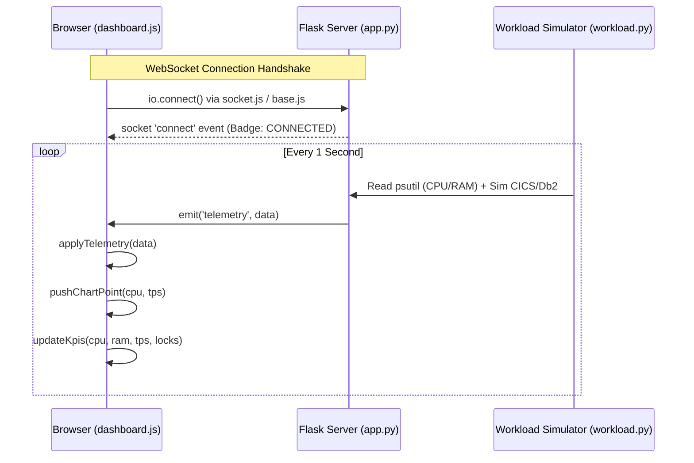
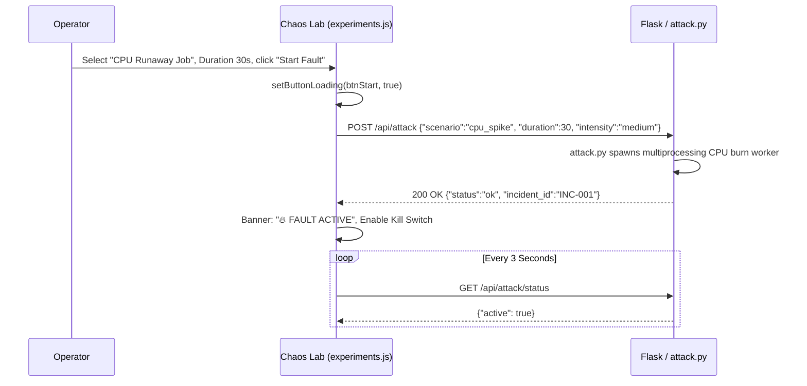
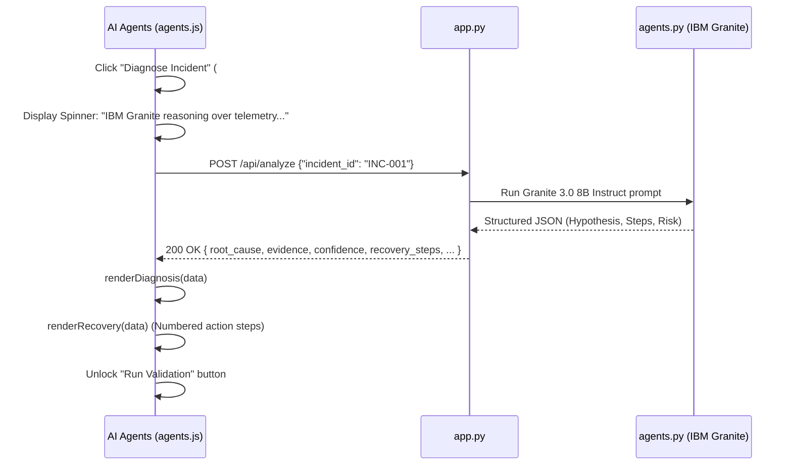
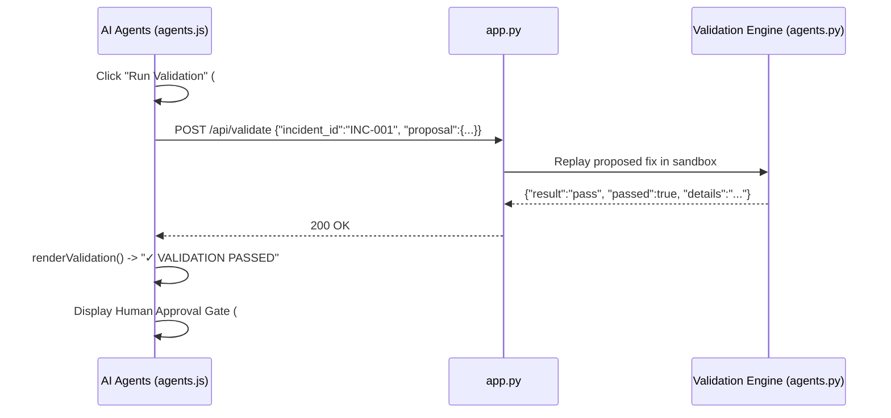
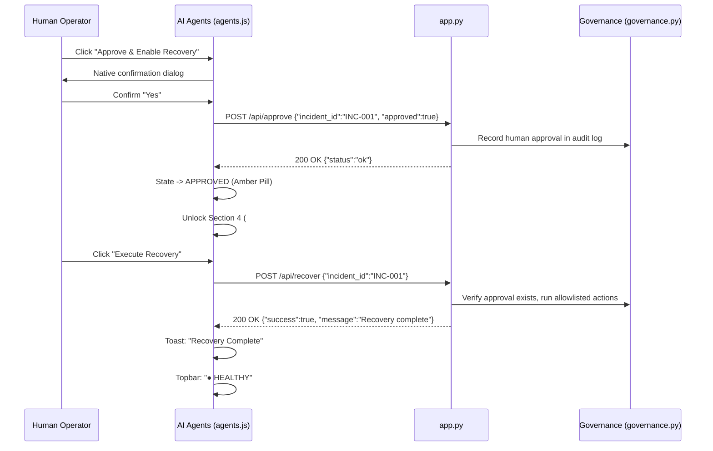
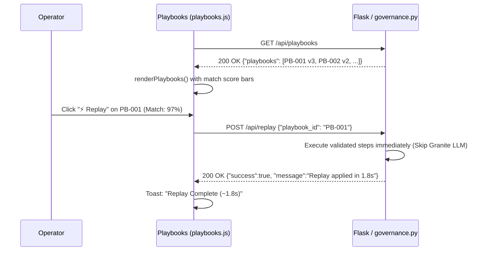
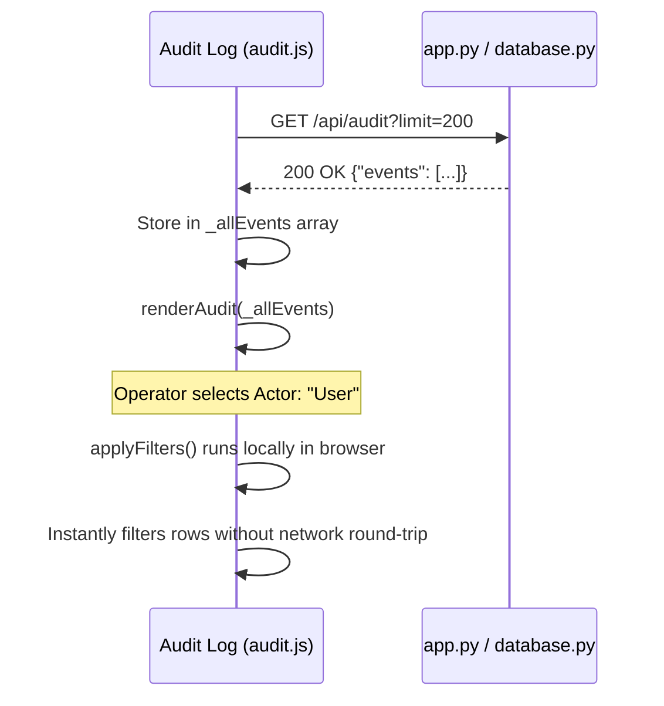

# Z-PHOENIX — End-to-End Frontend & Backend Integration Guide

> **Document Purpose:** Exact, step-by-step technical blueprint showing how the Z-PHOENIX frontend communicates with, triggers, and receives data from the backend services (`app.py`, `agents.py`, `attack.py`, `database.py`, `governance.py`, `workload.py`).  
> **Target Audience:** All team members (Kiran, Kishore, Ritu, Meer Mohammed Shoaib, Rishitha, and Nandan).  
> **Status:** Production-Ready Specification.

---

## 1. High-Level Integration Architecture

The Z-PHOENIX application is architected around a **hybrid transport model**:
1. **Flask Jinja2 Server-Side Rendering**: Serves template shells, navigation states, and page structures.
2. **REST JSON API**: Handles state changes, command dispatches, approvals, and queries.
3. **Flask-SocketIO WebSockets**: Streams high-frequency (1 Hz) telemetry and asynchronous agent events.
4. **Auto-Detecting Client Adapter**: Centralized in [`static/js/base.js`](file:///c:/Users/nanda/Desktop/Z-Phoenix/static/js/base.js) under the `window.ZP` namespace.

```text
 ┌──────────────────────────────────────────────────────────────────────────────────┐
 │                               CLIENT BROWSER                                     │
 │                                                                                  │
 │  ┌───────────────────────┐   ┌────────────────────────┐   ┌───────────────────┐  │
 │  │ Command Center        │   │ Chaos Lab              │   │ AI Agent Console  │  │
 │  │ (dashboard.js)        │   │ (experiments.js)       │   │ (agents.js)       │  │
 │  └───────────┬───────────┘   └───────────┬────────────┘   └─────────┬─────────┘  │
 │              │                           │                          │            │
 │              └─────────────────────┬─────┴──────────────────────────┘            │
 │                                    │                                             │
 │                     ┌──────────────▼──────────────┐                              │
 │                     │     window.ZP (base.js)     │                              │
 │                     │  - ZP.request / ZP.post     │                              │
 │                     │  - ZP.connectSocket (io)    │                              │
 │                     │  - checkHealth auto-detect  │                              │
 │                     └──────────────┬──────────────┘                              │
 └────────────────────────────────────┼─────────────────────────────────────────────┘
                                      │
                      HTTP REST JSON  │  WebSocket (Socket.IO)
                      Port 8080       │  Events: telemetry, agent_event
                                      │
 ┌────────────────────────────────────▼─────────────────────────────────────────────┐
 │                         BACKEND RUNTIME (app.py)                                 │
 │                                                                                  │
 │  ┌─────────────────────────┐  ┌────────────────────────┐  ┌───────────────────┐  │
 │  │ Workload & Telemetry    │  │ Chaos Engine           │  │ AI Agents         │  │
 │  │ (workload.py)           │  │ (attack.py)            │  │ (agents.py)       │  │
 │  │ - Host psutil metrics   │  │ - CPU / Lock workers   │  │ - Granite 3.0 8B  │  │
 │  │ - Simulated CICS/Db2    │  │ - Emergency stop kill  │  │ - Structured JSON │  │
 │  └─────────────────────────┘  └────────────────────────┘  └───────────────────┘  │
 │               │                            │                        │            │
 │               └─────────────────────┬──────┴────────────────────────┘            │
 │                                     ▼                                            │
 │                      ┌────────────────────────────┐                              │
 │                      │  Governance & Database     │                              │
 │                      │  (governance.py / db.py)   │                              │
 │                      │  - Approval gate policy    │                              │
 │                      │  - Immutable SQLite audit  │                              │
 │                      └────────────────────────────┘                              │
 └──────────────────────────────────────────────────────────────────────────────────┘
```

---

## 2. The Core Client Integration Engine (`static/js/base.js`)

All communication between browser pages and the Flask backend is governed by [`static/js/base.js`](file:///c:/Users/nanda/Desktop/Z-Phoenix/static/js/base.js).

### 2.1 The Central API Registry
Lines 22–35 define the exact URI paths:
```javascript
const API = {
  health:     '/api/health',
  telemetry:  '/api/telemetry',
  attack:     '/api/attack',
  analyze:    '/api/analyze',
  validate:   '/api/validate',
  approve:    '/api/approve',
  recover:    '/api/recover',
  playbooks:  '/api/playbooks',
  replay:     '/api/replay',
  passport:   '/api/recovery_passport',
  audit:      '/api/audit',
  incidents:  '/api/incidents',
};
```

### 2.2 The HTTP Request Wrapper (`ZP.request`)
Lines 162–198 implement `ZP.request(method, url, body, opts)`:
* **AbortController Timeout:** Enforces a hard **12,000 ms** timeout. If the backend freezes, the UI does not hang.
* **Headers:** Automatically sets `Content-Type: application/json` and `Accept: application/json`.
* **Safe Error Extraction:** Parses `{ error: "..." }` from non-2xx responses and surfaces it directly to user toasts.

### 2.3 Auto-Detection & Dual Mode (`checkHealth`)
Lines 213–224:
```javascript
async function checkHealth() {
  try {
    await ZP.get(API.health);
    setConnectionState('connected'); // Switches DEMO_MODE = false
    return true;
  } catch(_) {
    setConnectionState('demo');      // Keeps DEMO_MODE = true
    return false;
  }
}
```
* **Step 1:** On `DOMContentLoaded`, the browser calls `GET /api/health`.
* **Step 2 (Backend Offline):** Top-right badge shows `● DEMO MODE`. The UI uses internal simulation so you can always click and present.
* **Step 3 (Backend Online):** Top-right badge turns green: `● CONNECTED`. All button clicks immediately send real HTTP packets to Flask.

---

## 3. Step-by-Step Data Flow: The Golden Path

Here is exactly what happens in the code at each step of the 8-stage recovery lifecycle.

---

### Step 1: Baseline Telemetry Streaming



#### Code Execution Details:
1. `dashboard.js` initializes Chart.js on `<canvas id="telemetryChart">`.
2. `ZP.connectSocket()` in `base.js` connects via Socket.IO:
   ```javascript
   _socket.on('telemetry', (data) => applyTelemetry(data, false));
   ```
3. When payload arrives:
   - `valCpu`: Host CPU % updated. If `cpu > 80`, card border changes to red (`kpi-critical`).
   - `valRam`: Host RAM updated in GB (e.g., `2.1/4.0 GB`).
   - `valTps`: Simulated CICS throughput updated in `tx/s`.
   - `valLocks`: Simulated Db2 lock wait queue updated.
   - `_chart.update('none')`: Pushes data point onto the 60-second sliding array without recreating canvas objects.
4. **Fallback:** If Socket.IO is absent, `dashboard.js` runs `setInterval(fetchTelemetry, 2000)` calling `GET /api/telemetry`.

---

### Step 2: Chaos Injection (Chaos Lab)



#### Code Execution Details:
1. In `experiments.js`, line 105 listens to `#btnStartFault`.
2. Reads scenario radio button value (`cpu_spike`, `db2_lock_contention`, or `memory_pressure`).
3. Dispatches `ZP.post('/api/attack', { scenario, duration, intensity })`.
4. While request is in-flight:
   - `btnStart.disabled = true` (prevents double submissions).
   - Button content replaced with spinner.
5. On `200 OK`:
   - System state badge transitions to `⚠ INCIDENT ACTIVE`.
   - Emergency `#btnKillSwitch` is unlocked (`disabled = false`).
6. **Kill Switch Trigger:** If operator clicks `#btnKillSwitch`:
   - Sends `POST /api/attack/stop`.
   - Backend kills child chaos PIDs and clears locks.

---

### Step 3: AI Diagnosis (AI Agent Console)



#### Code Execution Details:
1. In `agents.js`, line 176 `doAnalyze()` triggers.
2. Sends `POST /api/analyze` with `incident_id`.
3. When response returns:
   - `renderDiagnosis()`:
     - Sets confidence meter: `<div class="confidence-fill" style="width: 91%;"></div>`.
     - Displays supporting evidence text.
     - Checks `is_fallback`: If backend returned a fallback response because Granite timed out, it renders an amber notice: `⚠ Deterministic fallback — Granite API unavailable`.
   - `renderRecovery()`:
     - Loops over `data.recovery_steps` array.
     - Creates DOM cards for Step 1 (`kill -15 4821`), Step 2 (`SET CURRENT DEGREE = 1`), Step 3 (`ROLLBACK`).
   - Unlocks next phase: `#sectionValidation` opacity set to `1.0`, `#btnValidate` enabled.

---

### Step 4: Sandbox Validation



#### Code Execution Details:
1. `doValidate()` in `agents.js` sends proposal JSON back to `POST /api/validate`.
2. On pass:
   - Sets pill text to `PASS` (`pill-healthy`).
   - Shows `#approvalControls`:
     ```javascript
     const ac = document.getElementById('approvalControls');
     if (ac) ac.style.display = 'flex';
     ```
   - Enables `#btnApprove` and `#btnReject`.
   - **Security Guarantee:** At this point, `#btnRecover` is still strictly disabled.

---

### Step 5: Human Approval Gate & Recovery Execution



#### Code Execution Details:
1. Operator clicks `#btnApprove`.
2. Native `confirm()` prompt verifies operator intent.
3. Sends `POST /api/approve`.
4. On success:
   - `_state = STATE.APPROVED`.
   - Enables `#sectionRecover`.
   - Unlocks `#btnRecover`.
5. Operator clicks `#btnRecover`.
6. Sends `POST /api/recover`.
7. Governance engine verifies that the action is allowlisted and approved, executes the remediation commands, and returns `success: true`.
8. Frontend fires `ZP.toast.success('Recovery Complete')` and resets system state badge to `● HEALTHY`.

---

### Step 6: One-Click Playbook Replay (Playbook Library)



#### Code Execution Details:
1. In `playbooks.js`, `loadPlaybooks()` fetches list from `GET /api/playbooks`.
2. Builds cards with ID, version, description, and match score bar.
3. The **Replay** button is only enabled for playbooks whose status is `APPROVED` or `VALIDATED`.
4. When clicked: sends `POST /api/replay` with `{ playbook_id: "PB-001" }`.
5. Bypasses the LLM diagnosis step, demonstrating the **2-second repeat recovery target** for hackathon judges!

---

### Step 7: Immutable Audit Log Filtering (`audit.js`)



#### Code Execution Details:
1. `audit.js` loads events from `GET /api/audit`.
2. Renders tabular rows containing Timestamp, Actor (System / User / Agent), Action, Target / Details, and Risk Level.
3. **Strict Read-Only Enforcement:** No delete, edit, or clear buttons exist in the DOM.
4. **Client-Side Filtering:** Filters on `#filterActor`, `#filterAction`, and `#filterRisk` run directly in JavaScript via `applyFilters()`, updating instantly without hitting the database repeatedly.

---

## 4. Exact Python / Flask Blueprint for Teammate Kiran (`app.py`)

Kiran can paste this minimal route scaffold into `app.py` to immediately bind all frontend pages and endpoints:

```python
from flask import Flask, render_template, jsonify, request
from flask_socketio import SocketIO, emit

app = Flask(__name__, static_folder='static', template_folder='templates')
socketio = SocketIO(app, cors_allowed_origins="*")

# ── 1. Page Template Routes ───────────────────────────────────────────────────

@app.route('/')
@app.route('/command-center')
def command_center():
    return render_template('command_center.html', active_page='dashboard')

@app.route('/chaos-lab')
def chaos_lab():
    return render_template('chaos_lab.html', active_page='experiments')

@app.route('/agents')
def agents():
    return render_template('agents.html', active_page='agents')

@app.route('/playbooks')
def playbooks():
    return render_template('playbooks.html', active_page='playbooks')

@app.route('/incidents')
def incidents():
    return render_template('incidents.html', active_page='incidents')

@app.route('/audit')
def audit():
    return render_template('audit.html', active_page='audit')

# ── 2. REST API Routes ────────────────────────────────────────────────────────

@app.route('/api/health')
def api_health():
    return jsonify({"status": "ok", "host": "linuxone", "version": "1.0"})

@app.route('/api/telemetry')
def api_telemetry():
    # Call workload.py / psutil
    return jsonify({
        "cpu": 24.5, "ram": 2.1, "ram_total": 4.0,
        "tps": 114.0, "db2_locks": 6, "system_state": "healthy"
    })

@app.route('/api/attack', methods=['POST'])
def api_attack():
    data = request.get_json() or {}
    # Call attack.py start_chaos(data['scenario'], data['duration'], data['intensity'])
    return jsonify({"status": "ok", "message": "Fault started", "incident_id": "INC-001"})

@app.route('/api/attack/stop', methods=['POST'])
def api_attack_stop():
    # Call attack.py stop_chaos()
    return jsonify({"status": "ok", "message": "Kill switch confirmed"})

@app.route('/api/analyze', methods=['POST'])
def api_analyze():
    # Call agents.py diagnose_and_propose(request.json['incident_id'])
    return jsonify({
        "incident_id": "INC-001",
        "root_cause": "...",
        "evidence": "...",
        "confidence_score": 0.91,
        "risk_level": "medium",
        "blast_radius": "...",
        "recovery_steps": [{"action": "kill -15 4821", "description": "..."}],
        "rollback_conditions": "...",
        "allowlisted_action_ids": ["kill-15"],
        "is_fallback": False
    })

@app.route('/api/validate', methods=['POST'])
def api_validate():
    # Call agents.py validate_proposal(...)
    return jsonify({"incident_id": "INC-001", "passed": True, "result": "pass", "details": "..."})

@app.route('/api/approve', methods=['POST'])
def api_approve():
    # Call governance.py record_approval(...)
    return jsonify({"status": "ok", "message": "Approval recorded"})

@app.route('/api/recover', methods=['POST'])
def api_recover():
    # Call governance.py execute_recovery(...)
    return jsonify({"status": "ok", "success": True, "message": "Recovery complete"})

@app.route('/api/playbooks')
def api_playbooks():
    # Query database.py for playbooks
    return jsonify({"playbooks": [...]})

@app.route('/api/replay', methods=['POST'])
def api_replay():
    # Call governance.py replay_playbook(request.json['playbook_id'])
    return jsonify({"status": "ok", "success": True, "message": "Replayed in 1.8s"})

@app.route('/api/incidents')
def api_incidents():
    # Query database.py for incident history and snapshots
    return jsonify({"incidents": [...]})

@app.route('/api/audit')
def api_audit():
    # Query database.py for audit_log entries
    return jsonify({"events": [...]})

# ── 3. WebSocket 1 Hz Telemetry Broadcaster ───────────────────────────────────

def background_telemetry_emitter():
    while True:
        socketio.sleep(1)
        # Read live metrics from workload.py
        payload = {
            "cpu": 25.0, "ram": 2.1, "ram_total": 4.0,
            "tps": 112.0, "db2_locks": 5, "system_state": "healthy"
        }
        socketio.emit('telemetry', payload)

if __name__ == '__main__':
    socketio.start_background_task(background_telemetry_emitter)
    socketio.run(app, host='0.0.0.0', port=8080, debug=True)
```

---

## 5. Summary Table: Endpoints & Handling Modules

| UI Action / Trigger | Frontend JS Function | HTTP Method & URI | Backend Owner | Module & Function |
|---|---|---|---|---|
| Page load health check | `checkHealth()` | `GET /api/health` | Kiran (M2) | `app.py` |
| Live telemetry update | `applyTelemetry()` | `GET /api/telemetry` or WS | Meer (M4) | `workload.py:get_telemetry()` |
| Start Chaos Fault | `btnStartFault.click()` | `POST /api/attack` | Meer (M4) | `attack.py:start_chaos()` |
| Emergency Kill Switch | `btnKillSwitch.click()` | `POST /api/attack/stop` | Meer (M4) | `attack.py:stop_chaos()` |
| Diagnose Anomaly | `doAnalyze()` | `POST /api/analyze` | Kishore (M1) | `agents.py:diagnose()` |
| Validate Fix in Sandbox| `doValidate()` | `POST /api/validate` | Kishore (M1) | `agents.py:validate()` |
| Human Approval Gate | `doApprove()` | `POST /api/approve` | Ritu (M3) | `governance.py:approve()` |
| Execute Recovery | `doRecover()` | `POST /api/recover` | Ritu (M3) | `governance.py:recover()` |
| List Playbooks | `loadPlaybooks()` | `GET /api/playbooks` | Ritu (M3) | `database.py:get_playbooks()` |
| One-Click Replay | `doReplay()` | `POST /api/replay` | Ritu / Kiran | `governance.py:replay()` |
| Incident Snapshots | `loadIncidents()` | `GET /api/incidents` | Ritu (M3) | `database.py:get_incidents()` |
| Audit Trail Fetch | `loadAudit()` | `GET /api/audit` | Ritu (M3) | `database.py:get_audit_log()` |

---

*This guide provides the complete, unambiguous integration contract between the frontend and backend teams.*
