<div align="center">

# 🔥 Z-PHOENIX
### *AI-Assisted Proactive Resilience & Recovery Rehearsal on IBM LinuxONE*

**A mission-critical enterprise resilience platform that combines controlled chaos engineering, real-time mainframe telemetry analysis, agentic AI diagnosis with IBM Granite 3.0, and strict human-in-the-loop governance to practice failure safely before production outages strike.**

---

[](https://www.ibm.com/it-infrastructure/linuxone)
[](https://ubuntu.com/)
[](https://www.python.org/)
[](https://www.ibm.com/granite)
[](https://flask.palletsprojects.com/)
[](https://socket.io/)
[-003B57?style=for-the-badge&logo=sqlite&logoColor=white)](https://www.sqlite.org/)
[](https://github.com/meer-md-shoaib/Z-Phoenix)
[](LICENSE)

<br/>

<!-- Interactive Quick Action Buttons -->
<p align="center">
  <a href="http://localhost:8080/">
    
  </a>
  &nbsp;&nbsp;
  <a href="http://localhost:8080/chaos">
    
  </a>
  &nbsp;&nbsp;
  <a href="http://localhost:8080/playbooks">
    
  </a>
  &nbsp;&nbsp;
  <a href="http://localhost:8080/audit">
    
  </a>
  &nbsp;&nbsp;
  <a href="https://github.com/meer-md-shoaib/Z-Phoenix/stargazers">
    
  </a>
</p>

</div>

---

## 📌 Table of Contents

- [💡 Overview & The Mainframe Resilience Problem](#-overview--the-mainframe-resilience-problem)
- [🎯 The Z-PHOENIX Mission](#-the-z-phoenix-mission)
- [✨ Key Innovations & Capabilities](#-key-innovations--capabilities)
- [🏗️ End-to-End System Architecture](#️-end-to-end-system-architecture)
- [🔄 The Golden Path: 8-Stage Rehearsal Lifecycle](#-the-golden-path-8-stage-rehearsal-lifecycle)
- [🛡️ Bounded Autonomy & Governance Engine](#️-bounded-autonomy--governance-engine)
- [🌪️ Chaos Engineering & Safety Mechanisms](#️-chaos-engineering--safety-mechanisms)
- [📊 Real-Time Mainframe Telemetry Model](#-real-time-mainframe-telemetry-model)
- [🛠️ Technology Stack](#️-technology-stack)
- [📂 Project Directory Structure](#-project-directory-structure)
- [🚀 Local & LinuxONE Deployment Guide](#-local--linuxone-deployment-guide)
- [⚙️ Environment Variables & Configuration](#️-environment-variables--configuration)
- [📡 REST API & WebSocket Event Reference](#-rest-api--websocket-event-reference)
- [👥 Meet the Team & Role Allocations](#-meet-the-team--role-allocations)
- [🔐 Shared Safety & Collaboration Rules](#-shared-safety--collaboration-rules)
- [🎥 Verification & Demo Assets](#-verification--demo-assets)
- [📄 License & Ethics](#-license--ethics)

---

## 💡 Overview & The Mainframe Resilience Problem

Mainframe and enterprise transaction systems (IBM Z, LinuxONE, CICS, and Db2) underpin **over 70% of the world's core financial and banking transactions**. In these high-throughput computing environments:
- **Downtime is Catastrophic:** Outages cost between **$100,000 to over $1,000,000 per hour** in lost transactions, regulatory fines, and brand damage.
- **The Cascade Effect:** A single runaway background job or uncommitted transaction rapidly exhausts shared compute resources, triggering a severe chain reaction:
  1. CPU spikes to 95–99%.
  2. Online CICS transaction rates plunge from **1000 TPS down to <100 TPS**.
  3. Db2 lock contention explodes from a baseline of **2 to 300+ blocked units of work**.
- **The "3 AM Scramble" Dilemma:** Site Reliability Engineers (SREs) typically debug complex mainframe incidents only during live, high-stress outages. Under pressure, operators execute manual, unverified terminal commands that risk corrupting state or dropping tables.
- **Unchecked AI Danger:** Autonomous AI agents given uncontrolled shell access represent an unacceptable security liability in banking infrastructure.

> [!CAUTION]
> **Zero Uncontrolled Shell Execution:** In high-consequence enterprise environments, AI must never be allowed to execute arbitrary operating system commands autonomously.

---

## 🎯 The Z-PHOENIX Mission

**Z-PHOENIX** transforms enterprise mainframe operations by introducing **proactive resilience and recovery rehearsal**. Instead of waiting for unpredicted production downtime, teams safely simulate bounded mainframe failures, evaluate root-cause hypotheses with **IBM Granite 3.0 8B Instruct**, validate scripted remediation through isolated sandboxes, enforce human approval gates, and persist verified fixes into versioned, 1-click replayable playbooks.

> *"Practice failure safely. Learn recovery. Be ready when it matters."*

---

## ✨ Key Innovations & Capabilities

<table>
  <tr>
    <td width="50%">
      <h3>🌪️ Sandboxed Chaos Injection</h3>
      <ul>
        <li><b>Mainframe Fault Injection:</b> Simulates bounded <code>CPU_RUNAWAY</code> jobs and severe <code>DB2_LOCK_CONTENTION</code> scenarios.</li>
        <li><b>Spawn Process Isolation:</b> Burner workers run in isolated Python multiprocessing spawn contexts so the control plane never locks up.</li>
        <li><b>Hard Safety Caps:</b> Capped worker pool (max 4), 50ms duty-cycling, and a <b>60-second emergency auto-kill timer</b>.</li>
        <li><b>Instant Kill Switch:</b> One-click emergency stop immediately terminates child workers and snaps metrics back to baseline.</li>
      </ul>
    </td>
    <td width="50%">
      <h3>🧠 3-Tier Agentic AI Rehearsal</h3>
      <ul>
        <li><b>IBM Granite 3.0 8B Instruct:</b> Specialized LLM integration via Groq Cloud or Hugging Face Inference API.</li>
        <li><b>Strict 4.0s Hard Timeout:</b> Spec-mandated execution budget preventing hanging or delayed incident response.</li>
        <li><b>Deterministic Fallbacks:</b> Returns structured, zero-error fallback payloads if network, provider, or JSON parse fails.</li>
        <li><b>Clear Separation of Concerns:</b> DiagnosisAgent (read-only) &rarr; RecoveryAgent (proposal-only) &rarr; ValidationAgent (sandbox-only).</li>
      </ul>
    </td>
  </tr>
  <tr>
    <td width="50%">
      <h3>🛡️ Bounded Autonomy & Human Gates</h3>
      <ul>
        <li><b>Non-Negotiable Human Approval:</b> AI can propose actions, but execution is blocked at HTTP 403 without an authenticated SRE sign-off.</li>
        <li><b>Strict Action Allowlist:</b> Enforces safe command prefixes (<code>ps</code>, <code>kill</code>, <code>db2</code>, <code>systemctl</code>, etc.).</li>
        <li><b>Destructive Command Regex Denylist:</b> Rejects patterns like <code>rm -rf</code>, <code>mkfs</code>, <code>dd</code>, <code>reboot</code>, fork bombs, and <code>DROP TABLE</code>.</li>
        <li><b>Immutable Audit Logging:</b> Persists actor identity, timestamp, risk tier, telemetry snapshots, and rationale for every action.</li>
      </ul>
    </td>
    <td width="50%">
      <h3>⚡ 1-Click Fast Replay (~2 Seconds)</h3>
      <ul>
        <li><b>Sub-2s Budget Execution:</b> Known, previously approved and validated incidents bypass LLM inference entirely.</li>
        <li><b>Instant Playbook Execution:</b> Pulls verified remediation scripts directly from SQLite and restores baseline health in milliseconds.</li>
        <li><b>Playbook Versioning:</b> Automatically versions fixes (<code>PB-001 v1 &rarr; v2</code>) while preserving historical audit trails.</li>
        <li><b>Replay Health Verification:</b> Confirms telemetry settles within the recovery envelope before closing incident tickets.</li>
      </ul>
    </td>
  </tr>
</table>

---

## 🏗️ End-to-End System Architecture

Z-PHOENIX coordinates telemetry streaming, bounded fault injection, agentic AI analysis, governance enforcement, and SQLite persistence into an asynchronous Flask-SocketIO control plane running on **IBM LinuxONE (s390x)**:

```text
                               +-------------------------------------------------------------+
                               |                  Z-PHOENIX COMMAND CENTER                   |
                               |      (Enterprise Dark Mainframe UI · Chart.js · SocketIO)   |
                               +------------------------------+------------------------------+
                                                              |
                                           1 Hz WebSocket & REST (Port 8080)
                                                              |
                               +------------------------------v------------------------------+
                               |                 app.py :: Flask Control Plane               |
                               |             (Eventlet Green Threads / Native Threads)       |
                               +---+--------------------------+--------------------------+---+
                                   |                          |                          |
               +-------------------+                          |                          +-------------------+
               |                                              |                                              |
               v                                              v                                              v
+-------------------------------+              +-------------------------------+              +-------------------------------+
|          workload.py          |              |           attack.py           |              |           agents.py           |
|  - Real Host CPU & RAM Stats  |              |  - Bounded Chaos Injector     |              |  - Diagnosis Agent            |
|  - Simulated CICS Workload    |              |  - CPU Runaway Simulation     |              |  - Recovery Proposal Agent    |
|  - Simulated Db2 Lock Waits   |              |  - Db2 Lock Storm Simulation  |              |  - Sandbox Validation Agent   |
|  - 1 Hz Telemetry Emitter     |              |  - 60s Emergency Auto-Kill    |              |  - IBM Granite 3.0 8B (4.0s)  |
|  - Breach Detection Engine    |              |  - Instant Kill Switch        |              |  - Deterministic Fallbacks    |
+-------------------------------+              +-------------------------------+              +---------------+---------------+
                                                                                                              |
                                                                                                              v
                               +-------------------------------------------------------------+  Staged Proposal
                               |                        governance.py                        | <--------------+
                               |  - Human Approval Gate (HTTP 403 Blocking Enforcement)      |
                               |  - Strict Command Allowlist & Regex Denylist Sanitizer      |
                               |  - Sub-2s 1-Click Replay Execution Engine                   |
                               +------------------------------+------------------------------+
                                                              |
                                                              v
                               +-------------------------------------------------------------+
                               |                         database.py                         |
                               |       (SQLite WAL Engine · Thread-Safe Connection Pool)     |
                               |  - incidents    : ID, Trigger, Snapshots, Status, Resolved  |
                               |  - playbooks    : Signature, Steps JSON, Risk, Version N+1  |
                               |  - audit_log    : Actor, Action, Risk Level, Evidence JSON  |
                               +-------------------------------------------------------------+
```

### 🧬 Rehearsal Lifecycle Flow (Mermaid Sequence)

```mermaid
sequenceDiagram
    autonumber
    actor SRE as On-Call SRE (Human Gate)
    participant UI as Command Center UI
    participant App as Flask / SocketIO Control Plane
    participant Workload as Telemetry Engine (workload.py)
    participant Chaos as Chaos Lab (attack.py)
    participant Agent as Granite AI Pipeline (agents.py)
    participant Gov as Governance Gate (governance.py)
    participant DB as SQLite Persistence (database.py)

    Note over Workload,UI: Baseline Stream (CPU ~25%, TPS ~1000, Locks ~2)
    Workload->>UI: 1 Hz Real-Time Telemetry Push
    
    rect rgb(35, 15, 15)
        Note over SRE,Chaos: Stage 2: Bounded Chaos Injection
        SRE->>UI: Trigger Fault (CPU_RUNAWAY / DB2_LOCK_CONTENTION)
        UI->>App: POST /api/chaos/inject
        App->>Chaos: attack.inject(fault, intensity)
        Chaos->>Workload: Escalate CPU -> 95%, TPS -> 90, Locks -> 380
    end

    rect rgb(40, 25, 10)
        Note over Workload,App: Stage 3: Incident Detection
        Workload->>App: Debounced Threshold Breach Detected
        App->>DB: database.create_incident(...)
        App->>UI: socket.emit("incident", incident_data)
    end

    rect rgb(30, 20, 45)
        Note over App,Agent: Stages 4-6: Agentic AI Pipeline
        App->>Agent: agents.diagnose(telemetry_snapshot)
        Agent-->>App: IBM Granite Diagnosis (4.0s timeout or Fallback)
        App->>Agent: agents.recover(diagnosis, telemetry)
        Agent-->>App: Remediation Script + Risk Tier (HIGH)
        App->>Agent: agents.validate(proposal)
        Agent-->>App: Sandbox Verdict: PASS (Allowlist Verified)
        App->>Gov: governance.stage_proposal(proposal)
        App->>UI: socket.emit("stages", AWAITING_APPROVAL)
    end

    rect rgb(15, 35, 20)
        Note over SRE,Gov: Stage 7: Bounded Autonomy & Human Approval
        Note right of SRE: AI Execution Blocked without Human Gate!
        SRE->>UI: Click [AUTHORIZE & EXECUTE RECOVERY]
        UI->>App: POST /api/approve { actor: "sre.oncall" }
        App->>Gov: governance.approve() -> governance.execute()
        Gov->>Chaos: attack.stop("RECOVERY_EXECUTED")
        Gov->>Workload: Reset Baseline Metrics
        Gov->>DB: database.store_playbook() & log_audit()
        App->>UI: Incident Cleared & Health Restored
    end

    rect rgb(10, 30, 40)
        Note over SRE,Gov: Stage 8: Sub-2s Fast Replay (Repeat Incidents)
        SRE->>UI: POST /api/replay/PB-001
        App->>Gov: governance.replay(playbook_ref)
        Gov->>Chaos: Stop Chaos & Restore Baseline
        Gov-->>UI: Replay Finished in ~1,840 ms (AI Bypassed)
    end
```



---

## 🔄 The Golden Path: 8-Stage Rehearsal Lifecycle

The Z-PHOENIX Golden Path guides an engineering team through the complete incident lifecycle without taking down real production workloads:

| Stage # | Stage Name | Visual Status | Description & Operational Guarantees |
|:---:|---|:---:|---|
| **1** | **Baseline** | 🟢 Healthy | Continuous 1 Hz telemetry stream (`CPU ~25%`, `RAM ~2.1 GB`, `TPS ~1000`, `Db2 Locks ~2`). |
| **2** | **Chaos Injection** | 🔴 Injected | Injects bounded fault via isolated worker processes. 60-second emergency auto-kill active. |
| **3** | **Detection** | 🟠 Triggered | Threshold breach debounced over 2 consecutive ticks opens official incident ticket. |
| **4** | **Diagnosis** | 🟣 Reasoning | **IBM Granite 3.0 8B Instruct** inspects telemetry (4.0s hard timeout; deterministic fallback on failure). |
| **5** | **Recovery Proposal** | 🟣 Staged | Recovery Agent drafts remediation script, assigns risk tier (`LOW`, `MEDIUM`, `HIGH`). |
| **6** | **Validation** | 🟢 Verified | Validation Agent dry-runs proposed script against command allowlist and destructive denylist. |
| **7** | **Human Approval Gate** | 🟡 Gate Lock | **Bounded Autonomy Enforced.** AI cannot execute. Explicit SRE human operator authorization required. |
| **8** | **Store & Fast Replay** | 🔵 Persisted | Stored as versioned playbook (`PB-001 v(N+1)`). Future repeat incidents replay in **~2 seconds**. |

---

## 🛡️ Bounded Autonomy & Governance Engine

In mission-critical banking architectures, allowing an AI agent to execute shell commands directly creates catastrophic risk. Z-PHOENIX implements an airtight governance protocol:

```text
[AI Proposes Plan] ---> [Sandbox Validation] ---> [Human Approval Gate] ---> [Strict Sanitizer] ---> [Execution]
                                                         |
                                                (Blocked: HTTP 403)
                                             Without Human Signature
```

### 1. State Machine of Approval Gate
- `EMPTY`: No proposal staged.
- `AWAITING_APPROVAL`: Recovery proposal staged and validated; awaiting human operator signature. Direct execution requests return **HTTP 403 Forbidden**.
- `APPROVED`: Authenticated SRE (`sre.oncall`) signed off on proposal.
- `REJECTED`: SRE rejected proposal; chaos remains active until manual kill switch.
- `EXECUTED`: Actions executed and committed to immutable audit log.

### 2. Command Allowlist (`config.py`)
Only commands starting with explicit, safe administrative prefixes are allowed:
```python
ALLOWED_COMMAND_PREFIXES = (
    "ps ", "kill ", "mod ", "db2 ", "systemctl ",
    "service ", "echo ", "sleep ", "ip ", "chsys"
)
```

### 3. Destructive Command Denylist (Regex Guardrails)
Any proposal containing destructive patterns is rejected immediately by the Validation Agent and blocked by the Governance Gate:
```python
DENIED_COMMAND_PATTERNS = (
    r"\brm\s+-[rf]*\s",                     # Recursive file deletion
    r"\bmkfs",                              # Filesystem formatting
    r"\bdd\s+if=",                          # Raw disk overwriting
    r"\b(shutdown|reboot|halt|poweroff)\b", # System power actions
    r":\(\)\s*\{",                          # Fork bombs
    r"\bchmod\s+777\b",                     # Insecure permissions
    r">\s*/dev/sd",                         # Direct block device writes
    r"\bdrop\s+(table|database)\b",         # SQL destruction
    r"\btruncate\s+table\b",                # SQL truncation
)
```

### 4. Immutable Audit Log Trail
Every action records:
- `timestamp`: UTC ISO-8601 millisecond timestamp.
- `actor`: `sre.oncall`, `granite.agent`, `chaos.lab`, or `replay.engine`.
- `action`: `CHAOS_INJECT`, `INCIDENT_OPENED`, `PROPOSAL_STAGED`, `APPROVED`, `EXECUTED`, `REPLAY`.
- `risk_level`: `LOW`, `MEDIUM`, or `HIGH`.
- `evidence_json`: Complete telemetry snapshot, parameters, and justification.

---

## 🌪️ Chaos Engineering & Safety Mechanisms

Z-PHOENIX executes controlled chaos without endangering the host system or virtual partition:

```text
┌────────────────────────────────────────────────────────────────────────┐
│                       CHAOS SAFETY ENVELOPE                            │
├────────────────────────────────┬───────────────────────────────────────┤
│ Max Concurrent Workers         │ 4 processes (multiprocessing spawn)   │
│ Hard Auto-Kill Timeout         │ 60.0 Seconds (Dual Timer Protection)  │
│ Duty Cycle Burning             │ 50ms work slice / 10ms pause slice   │
│ CPU Intensity Range            │ 10% minimum - 100% maximum            │
│ Emergency Stop Kill Switch     │ Instant SIGTERM to worker children    │
│ Target Cleanliness             │ Zero orphaned processes guaranteed   │
└────────────────────────────────┴───────────────────────────────────────┘
```

### Supported Fault Scenarios
1. **`CPU_RUNAWAY` (Runaway CICS Job):** Simulates an unconstrained batch/online transaction pinning CPU cores at >92%. Telemetry captures the resulting collapse in CICS transaction throughput and climbing lock-wait queues.
2. **`DB2_LOCK_CONTENTION` (Uncommitted Unit of Work):** Simulates an exclusive page lock pinned by an idle batch job. Telemetry shows TPS plummeting while Db2 lock waits surge past 300.

---

## 📊 Real-Time Mainframe Telemetry Model

The telemetry engine reads real host metrics (via `/proc/stat` and `/proc/meminfo` on Linux, falling back safely on other OSs) and merges them with simulated mainframe metrics:

| Metric Indicator | Healthy Baseline | Degraded Band | Critical Threshold | Recovery Envelope |
|---|:---:|:---:|:---:|:---:|
| **Host CPU Utilization** | `25.0%` | `> 60.0%` | `> 90.0%` | `< 45.0%` |
| **Resident RAM (Host/LPAR)** | `~2.1 GB` | `> 4.5 GB` | `> 7.0 GB` | `< 3.5 GB` |
| **CICS Transactions (TPS)** | `1000 txn/s` | `< 600 txn/s` | `< 150 txn/s` | `> 800 txn/s` |
| **Db2 Lock Wait Count** | `2 waits` | `> 50 waits` | `> 300 waits` | `< 20 waits` |

---

## 🛠️ Technology Stack

| Layer | Technology | Specification / Role |
|---|---|---|
| **Host Architecture** | **IBM LinuxONE** | s390x enterprise mainframe environment running Ubuntu 24.04 LTS |
| **Application Runtime** | **Python 3.12** | Core language for backend services, agents, chaos engine, and telemetry |
| **Web & Concurrency** | **Flask 3.0 + SocketIO** | Cooperative green threads via **Eventlet** (native thread fallback) |
| **AI / LLM Diagnostics** | **IBM Granite 3.0 8B** | `ibm-granite/granite-3.0-8b-instruct` via Groq Cloud or Hugging Face |
| **Database Persistence** | **SQLite 3** | WAL mode, thread-safe connection pooling, idempotent schema initialization |
| **Chaos Injection** | **Multiprocessing Spawn** | Process-isolated CPU burners with dual 60s auto-kill timers |
| **Frontend UI / UX** | **Vanilla CSS + JS** | Responsive enterprise dark mainframe console (`#0B0F19`), zero heavy frameworks |
| **Real-time Charts** | **Chart.js 4.x** | Dynamic 1 Hz scrolling telemetry charts with color-coded status bands |
| **Streaming Protocol** | **WebSockets (Socket.IO)** | Bidirectional 1 Hz telemetry push, pipeline stages, incident alerts, and audit logs |

---

## 📂 Project Directory Structure

```text
z-phoenix/
├── app.py                      # Flask app, SocketIO setup, API routes & page routers
├── config.py                   # System configs, thresholds, Granite API keys & fallbacks
├── agents.py                   # Diagnosis, Recovery & Validation agents with Granite
├── attack.py                   # Sandboxed chaos engine, worker caps & kill switch
├── governance.py               # Human approval gates, command allowlist & replay engine
├── workload.py                 # Telemetry engine, real host metrics & socket streamer
├── database.py                 # SQLite schema, incidents, playbooks & audit logging
├── requirements.txt            # flask, flask-socketio, requests, eventlet
├── Z_PHOENIX_FULL_DEMO.mp4     # Full end-to-end rehearsal demonstration video
├── zphoenix_complete_demo.mp4  # Compact backup presentation video
├── scratch/                    # Temporary scratch scripts & testing payloads
├── static/
│   ├── css/
│   │   └── style.css           # Enterprise mainframe dark theme, grid layout & badges
│   └── js/
│       ├── socket.js           # WebSocket connection, reconnection & event dispatcher
│       ├── charts.js           # Chart.js initialization & live 1 Hz rolling charts
│       └── app.js              # Command center controls, stage stepper & console logs
├── templates/
│   ├── base.html               # Master shell layout (sidebar, topbar, status indicator)
│   ├── command_center.html     # Main operations dashboard & 8-stage rehearsal pipeline
│   ├── chaos_lab.html          # Fault injection controls, slider & emergency stop
│   ├── playbooks.html          # Versioned playbook library & 1-click replay interface
│   └── audit.html              # Full immutable governance audit log & JSON viewer
└── tests/                      # Automated test suite (Golden path, failure modes, safety)
```

---

## 🚀 Local & LinuxONE Deployment Guide

### Prerequisites
- **Python 3.12+** installed.
- **Git** installed.
- (Optional) **Groq API Key** or **Hugging Face Token** for live Granite 3.0 LLM inference. *(Z-PHOENIX includes deterministic fallbacks and operates with 100% functionality even without an API key).*

### 1. Clone the Repository
```bash
git clone https://github.com/meer-md-shoaib/Z-Phoenix.git
cd Z-Phoenix
```

### 2. Create and Activate Virtual Environment
```bash
# On Linux / macOS / IBM LinuxONE
python3 -m venv venv
source venv/bin/activate

# On Windows PowerShell
python -m venv venv
.\venv\Scripts\Activate.ps1
```

### 3. Install Dependencies
```bash
pip install --upgrade pip
pip install -r requirements.txt
```

### 4. Configure Environment Variables (Optional)
```bash
# For live IBM Granite 3.0 inference via Groq:
export GROQ_API_KEY="your-groq-api-key"
export GRANITE_PROVIDER="groq"

# Or via Hugging Face Inference:
export HF_API_TOKEN="your-hf-token"
export GRANITE_PROVIDER="huggingface"

# Set custom port or database path if desired:
export PORT=8080
export Z_PHOENIX_DB="z_phoenix.db"
```

### 5. Launch the Platform
```bash
python app.py
```

The console will output the startup banner:
```text
  Z-PHOENIX :: AI-assisted proactive resilience & recovery rehearsal
  IBM LinuxONE · s390x · Ubuntu 24.04 · Python 3.12
  listening on http://0.0.0.0:8080 (async_mode=eventlet, model=ibm-granite/granite-3.0-8b-instruct, granite_timeout=4.0s)
```

Open your browser and navigate to **`http://localhost:8080`**.

---

## ⚙️ Environment Variables & Configuration

All options are configurable in `config.py` or via standard environment variables:

| Variable | Default Value | Description |
|---|:---:|---|
| `PORT` | `8080` | Port for Flask web server and WebSocket engine |
| `HOST` | `0.0.0.0` | Bind host address |
| `Z_PHOENIX_DB` | `z_phoenix.db` | File path for SQLite persistence database |
| `Z_PHOENIX_ASYNC_MODE` | *(auto-detected)* | Concurrency mode (`eventlet` or `threading`) |
| `GRANITE_PROVIDER` | `groq` | LLM API provider (`groq` or `huggingface`) |
| `GRANITE_MODEL` | `ibm-granite/granite-3.0-8b-instruct` | Model identifier for diagnostics |
| `GROQ_API_KEY` | `""` | API key for Groq Cloud inference |
| `HF_API_TOKEN` | `""` | API key for Hugging Face Inference API |
| `GRANITE_TIMEOUT` | `4.0` | Hard timeout in seconds for agent LLM calls |
| `CHAOS_MAX_WORKERS` | `4` | Maximum concurrent CPU burner child processes |
| `CHAOS_MAX_DURATION_SEC`| `60` | Emergency auto-kill timer for chaos fault workers |

---

## 📡 REST API & WebSocket Event Reference

### REST Endpoints

| Method | Endpoint | Description | Status Codes |
|:---:|---|---|:---:|
| `GET` | `/api/status` | Application configuration, LLM model info, and readiness | `200` |
| `GET` | `/api/telemetry` | Current telemetry sample, chaos status, and stage snapshot | `200` |
| `GET` | `/api/flow` | Current 8-stage pipeline state and pending approval gate | `200` |
| `POST` | `/api/chaos/inject` | Injects bounded fault (`fault_type`, `intensity`) | `200`, `400`, `500` |
| `POST` | `/api/chaos/stop` | Triggers emergency kill switch to stop all chaos workers | `200` |
| `POST` | `/api/diagnose` | Triggers Granite 3.0 root-cause analysis on telemetry | `200` |
| `POST` | `/api/propose` | Staged Recovery Agent remediation plan with risk tier | `200`, `400` |
| `POST` | `/api/validate` | Sandboxed dry-run of proposal against allowlist/denylist | `200`, `409` |
| `POST` | `/api/approve` | Human SRE records approval and executes remediation | `200`, `403` |
| `POST` | `/api/reject` | Human SRE rejects proposal; clears pending approval gate | `200`, `403` |
| `POST` | `/api/execute` | Direct execution endpoint (Strictly blocked without prior approval) | `200`, `403` |
| `POST` | `/api/replay/<id>` | 1-Click fast replay of validated playbook (~2 seconds) | `200`, `403` |
| `GET` | `/api/incidents` | List recent recorded incidents | `200` |
| `GET` | `/api/playbooks` | List versioned remediation playbooks | `200` |
| `GET` | `/api/audit` | Retrieve immutable governance audit log | `200` |
| `GET` | `/api/pending` | Query current human approval gate state | `200` |

### WebSocket Events (1 Hz Socket.IO Stream)

| Event Name | Direction | Payload Description |
|---|:---:|---|
| `telemetry` | Server &rarr; Client | Real-time CPU, RAM, CICS TPS, Db2 Lock-Waits, and Health state |
| `stages` | Server &rarr; Client | Active stage state in the 8-stage Golden Path stepper |
| `incident` | Server &rarr; Client | Broadcast when debounced threshold breach creates new incident |
| `incident_cleared` | Server &rarr; Client | Broadcast when metrics return within the recovery envelope |
| `agent_event` | Server &rarr; Client | AI Diagnosis, Recovery Proposal, and Validation results |
| `audit_event` | Server &rarr; Client | Live append to the frontend governance audit stream |
| `console` | Server &rarr; Client | Real-time terminal log messages (`critical`, `warn`, `ok`, `ai`) |

---

## 👥 Meet the Team & Role Allocations

<div align="center">

| Member | Name | Role | Primary Files Owned |
|:---:|---|---|---|
| **M1** | **Kishore** | AI Diagnostics & Agent Engineer | `agents.py`, `config.py` |
| **M2** | **Kiran** | Backend & Workflow Engineer | `app.py`, `requirements.txt` |
| **M3** | **Ritu** | Database & Governance Engineer | `database.py`, `governance.py` |
| **M4** | **Meer Mohammed Shoaib** | Telemetry, Chaos & Simulation Engineer | `attack.py`, `workload.py` |
| **M5** | **Nandan** | Frontend & Visualization Engineer | `templates/`, `static/css/`, `static/js/` |
| **M6** | **Rishitha** | Integration Automation, QA & Demo Video Lead | `tests/`, `scripts/` |

</div>

---

### 🧠 Member 1: Kishore
#### AI Diagnostics & Agent Engineer
* **Files Owned:** `agents.py`, `config.py`
* **Responsibilities:**
  - Integrate **IBM Granite 3.0 8B Instruct** via Groq Cloud API and Hugging Face inference endpoints.
  - Implement the three distinct agent personas: **DiagnosisAgent** (root-cause analysis), **RecoveryAgent** (scripted remediation), and **ValidationAgent** (sandbox checking).
  - Enforce strict JSON output schemas: root-cause hypothesis, telemetry evidence, confidence score, risk tier, and executable commands.
  - Implement the mandatory **4.0-second hard timeout** and catch all network, DNS, TLS, and parse failures.
  - Implement zero-dependency deterministic fallback payloads so the control plane functions reliably offline.
  - Ensure AI agents remain proposal-only and cannot execute commands directly.
* **Definition of Done:**
  - Agents return predictable structured JSON payloads.
  - API timeouts and network dropouts never crash or block the application.
  - Fallback responses engage seamlessly when no API credentials are provided.
  - Agents can never bypass governance approval gates.

---

### ⚙️ Member 2: Kiran
#### Backend & Workflow Engineer
* **Files Owned:** `app.py`, `requirements.txt`
* **Responsibilities:**
  - Build the Flask application and integrate Flask-SocketIO with **Eventlet** green threads and threading fallbacks.
  - Implement standard REST API endpoints with consistent response envelopes (`ok: true/false`).
  - Wire the complete Golden Path: Telemetry &rarr; Chaos &rarr; Detection &rarr; Diagnosis &rarr; Validation &rarr; Approval &rarr; Execution &rarr; Replay.
  - Stream 1 Hz telemetry and stage transitions over WebSockets to connected browsers.
  - Enforce HTTP status codes (`400 Bad Request`, `403 Forbidden`, `404 Not Found`, `409 Conflict`).
* **Definition of Done:**
  - The complete 8-stage rehearsal lifecycle operates end-to-end.
  - SocketIO reliably pushes 1 Hz metrics without dropping connections during AI calls.
  - Recovery requests strictly pass through governance checks.
  - Application cleanly starts on IBM LinuxONE port 8080.

---

### 🗄️ Member 3: Ritu
#### Database & Governance Engineer
* **Files Owned:** `database.py`, `governance.py`
* **Responsibilities:**
  - Design and initialize the thread-safe SQLite database schema (`incidents`, `playbooks`, `audit_log`).
  - Implement idempotent table creation and seed default playbooks (`PB-001`, `PB-002`).
  - Implement the bounded autonomy governance state machine (`EMPTY`, `AWAITING_APPROVAL`, `APPROVED`, `REJECTED`, `EXECUTED`).
  - Implement the strict command allowlist and regex-based destructive pattern denylist.
  - Maintain versioned playbooks (`v1 &rarr; v2 &rarr; v3`) without overwriting historical records.
  - Record immutable audit logs for every actor action with millisecond timestamps and telemetry snapshots.
* **Definition of Done:**
  - Database schema initializes reliably on any environment.
  - Unapproved execution attempts are blocked with `ApprovalError (HTTP 403)`.
  - Playbook versioning preserves complete historical revisions.
  - Audit trail immutably records all AI, system, and human actions.

---

### ⚡ Member 4: Meer Mohammed Shoaib
#### Telemetry, Chaos & Simulation Engineer
* **Files Owned:** `attack.py`, `workload.py`
* **Responsibilities:**
  - Implement real host CPU and RAM metric collection via `/proc/stat` and `/proc/meminfo` with cross-platform fallbacks.
  - Simulate enterprise CICS transaction throughput (TPS) and Db2 lock-wait queue telemetry.
  - Build the bounded chaos engine with two core scenarios: `CPU_RUNAWAY` and `DB2_LOCK_CONTENTION`.
  - Isolate chaos burner processes using Python `multiprocessing.get_context("spawn")`.
  - Enforce strict safety limits: hard worker cap (max 4), 50ms duty-cycle busy loops, and **60-second emergency auto-kill**.
  - Implement the instant emergency kill switch (`attack.stop()`) that terminates child processes and resets metrics to baseline.
* **Definition of Done:**
  - Fault scenarios ramp metrics to critical thresholds within 2.5 seconds.
  - Resource and duration caps prevent host lockup under all conditions.
  - Emergency kill switch reliably cleans up all child worker processes with zero orphans.
  - Host CPU and memory remain responsive throughout chaos runs.

---

### 🎨 Member 5: Nandan
#### Frontend & Visualization Engineer
* **Files Owned:** `templates/`, `static/css/style.css`, `static/js/socket.js`, `static/js/charts.js`, `static/js/app.js`
* **Responsibilities:**
  - Build a responsive, enterprise-grade mainframe dark console UI (`#0B0F19`) with custom styling.
  - Create the Command Center, Chaos Lab, Playbook Vault, and Audit Log views.
  - Implement rolling Chart.js telemetry charts for CPU, RAM, CICS TPS, and Db2 Lock-Waits with color-coded threshold zones.
  - Render the 8-stage interactive Golden Path stepper reflecting real-time pipeline states.
  - Wire the human approval modal and emergency kill switch buttons to backend APIs.
  - Clearly label simulated CICS and Db2 mainframe metrics.
* **Definition of Done:**
  - All four pages are responsive, functional, and visually aligned with enterprise mainframe aesthetics.
  - Charts update smoothly at 1 Hz via WebSocket events without memory leaks.
  - Human approval gate and kill switch controls respond instantly.
  - Error and loading states are gracefully presented in the UI console.

---

### 🧪 Member 6: Rishitha
#### Integration Automation, QA & Demo Video Lead
* **Files Owned:** `tests/`, `scripts/`
* **Responsibilities:**
  - Develop integration tests covering the complete Golden Path lifecycle.
  - Implement failure-mode test suites: AI timeouts, malformed JSON, rejected approvals, and forbidden command execution.
  - Verify chaos safety limits, worker process cleanups, and auto-kill expiration.
  - Benchmark 1-click fast playbook replay performance against the **sub-2 second target budget**.
  - Validate system readiness: Python 3.12 dependencies, port 8080 binding, SQLite tables, and Granite configuration.
  - Record, edit, and verify the offline backup demonstration video.
* **Definition of Done:**
  - Automated tests verify Golden Path and failure modes pass reliably.
  - Playbook replay benchmarks consistently achieve the ~2-second performance target.
  - Readiness checks validate environment prerequisites on IBM LinuxONE.
  - Backup demonstration video (`Z_PHOENIX_FULL_DEMO.mp4`) is playable and verified offline.

---

## 🔐 Shared Safety & Collaboration Rules

To guarantee enterprise-grade software stability and team integrity:
1. **Bounded Autonomy:** AI agents propose recovery actions; they can **never** directly execute shell commands without human approval.
2. **Mandatory Human Approval:** Execution without recorded human sign-off returns `HTTP 403 Forbidden`.
3. **Chaos Bounding:** Fault simulations must never exceed 4 workers or 60 seconds of execution.
4. **Targeted Cleanup:** The emergency kill switch must terminate only child processes spawned by the chaos engine.
5. **Full Auditability:** Every action by an AI agent, human operator, or system component must be logged to the immutable audit trail.
6. **Credential Hygiene:** Never commit API keys, secrets, credentials, or `.env` files to git repositories.
7. **Clean Version Control:** Exclude virtual environments (`venv/`), database files (`*.db`), and cache files (`__pycache__/`).
8. **Code Ownership:** Coordinate before editing files owned by another team member.
9. **Branching Strategy:** Use feature branches and PRs rather than pushing directly to `main`.
10. **Data Transparency:** Always clearly label simulated CICS and Db2 telemetry in UI dashboards and demos.
11. **Demo Readiness:** Maintain a known-good backup video and local snapshot for offline presentation.

---

## 🎥 Verification & Demo Assets

The repository includes pre-recorded, verified demonstration videos illustrating the complete Golden Path:
- **`Z_PHOENIX_FULL_DEMO.mp4`**: Complete high-definition video walkthrough showcasing baseline monitoring, chaos fault injection, IBM Granite 3.0 diagnostics, human approval gate, and fast replay.
- **`zphoenix_complete_demo.mp4`**: Compact, portable demonstration recording for backup evaluation.

---

## 📄 License & Ethics

Distributed under the **MIT License**. See `LICENSE` for more information.

Z-PHOENIX was developed with a dedication to safety, ethical AI governance, and resilient computing on **IBM LinuxONE**. All simulated faults are bounded by design and intended exclusively for resilience testing, education, and disaster recovery rehearsal.

---

<div align="center">

**🔥 Z-PHOENIX — Practice failure safely. Learn recovery. Be ready when it matters.**

Made with ❤️ by the **Z-PHOENIX Engineering Team**

</div>
